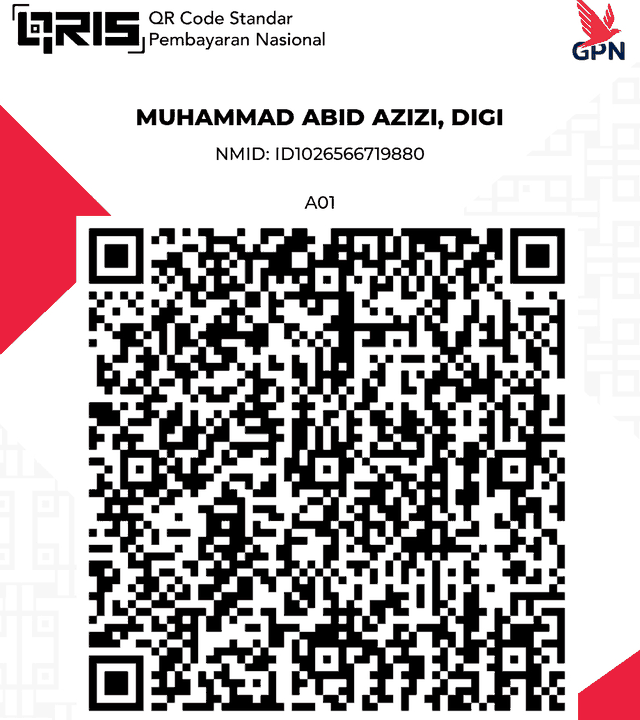

# KAYA — Financial Tracker

Pencatat keuangan pribadi berbasis **Google Sheets + Google Apps Script**. Datamu tersimpan di Google Sheets milikmu sendiri, tanpa server pihak ketiga. Tampilan mobile-first (dipasang sebagai PWA lewat Cloudflare Worker), bahasa Indonesia.

> Versi: **v1.0.0 (Public Release)** · by Abidzi

[](#dukung-kaya)

## Fitur

- Catat pemasukan dan pengeluaran, transfer antar rekening, kategori dan budget bulanan
- Banyak akun: Aset, E-money, dan Kartu Kredit (tagihan, limit, siklus tagihan)
- Hutang/piutang, tabungan target, cicilan (termasuk cicilan kartu kredit), transaksi berulang + auto-pay
- Investasi (nilai sekarang, modal, jual)
- Split kategori, split bill, dan titipan
- Pencatatan otomatis dari notifikasi iPhone (iPhone Shortcuts + webhook), antrean "Perlu Diperiksa" untuk notifikasi yang tidak pasti
- Sinkron saldo E-Money dari file eChis
- Import transaksi dari file/gambar (OCR)

## Cara pasang (±15 menit)

1. Buat Google Sheet baru, lalu buka **Extensions → Apps Script**.
2. Salin semua file `.js` ke project sebagai file Script (`Code`, `Database`, `Emoney`, `Titip`) dan semua file `.html` sebagai file HTML (`Index`, `JS_Core`, `JS_Logo`, dst). **Nama file harus sama persis** (tanpa ekstensi), karena `Index.html` memanggilnya lewat `include_('JS_Core')` dan seterusnya.
3. Tampilkan `appsscript.json` (Project Settings → *Show "appsscript.json" manifest file*) lalu isi dengan file `appsscript.json` dari repo ini. Pastikan layanan lanjutan **Drive API (v2)** aktif (Services → Drive API), karena dipakai untuk OCR dan sinkron E-Money.
4. Muat ulang Google Sheet. Menu **💰 KAYA** akan muncul. Pilih **Setup Awal**, lalu izinkan akses saat diminta. Setup membuat semua sheet, trigger harian (01:00), dan **token webhook acak** yang ditampilkan sekali di layar.
5. Di editor Apps Script: **Deploy → New deployment → Web app**
   - Execute as: **Me**
   - Who has access: **Anyone** (wajib agar webhook iPhone Shortcuts bisa masuk)
6. Salin URL `/exec` hasil deploy. **Jangan dipakai langsung sebagai aplikasi**, lanjut ke langkah 7.
7. **Pasang Cloudflare Worker (wajib).** Tampilan KAYA dirancang untuk diperkecil lewat `UI_SCALE` di `worker.js`. Kalau URL `/exec` dibuka langsung, UI akan terlihat terlalu besar.
   - Cloudflare Dashboard → **Workers & Pages → Create → Hello World** → beri nama (mis. `kaya`) → **Deploy**.
   - Klik **Edit code**, ganti seluruh isinya dengan `worker.js` dari repo ini.
   - Di baris pertama, isi `GAS_URL` dengan URL `/exec` dari langkah 6, lalu **Deploy**.
   - Buka `https://<nama-worker>.<akun>.workers.dev/`. Itu aplikasimu. Di iPhone: Share → *Add to Home Screen*.

Setelah mengubah kode Apps Script, deploy ulang lewat **Manage deployments → Edit → New version** agar URL `/exec` tidak berubah (jadi `GAS_URL` tidak perlu diganti). Setelah mengubah `worker.js`, deploy ulang Worker.

Worker menampilkan aplikasi di dalam iframe, menyediakan manifest PWA dan ikon, serta menerapkan skala tampilan. Tidak ada logika bisnis atau rahasia di Worker. Kalau tampilan terasa terlalu besar atau kecil, ubah `UI_SCALE` (bawaan `0.85`).

### Opsional: pencatatan otomatis dari notifikasi (iPhone Shortcuts)

Buat Automation tipe *Notification* per aplikasi, lalu aksi *Get Contents of URL*:

- URL: URL `/exec` Apps Script-mu (bukan URL workers.dev)
- Method: `POST`, Request Body: **JSON**

```json
{
  "token": "<token dari menu KAYA → Lihat Token Webhook>",
  "app": "Gopay",
  "account": "E-Wallet",
  "title": "<Notification Title>",
  "text": "<Notification Body>"
}
```

`account` harus sama dengan nama akun di sheet **Akun**. Notifikasi yang tidak dikenali masuk ke sheet **Log Notifikasi** dan muncul di antrean **Perlu Diperiksa**. Tambahkan kata kunci merchant di sheet **Kata Kunci** supaya kategori terisi otomatis (baris paling atas yang cocok dipakai).

## Keamanan — baca ini

- Web app harus berakses **Anyone** agar webhook bisa masuk. Artinya **siapa pun yang tahu URL `/exec` atau URL workers.dev-mu bisa membuka aplikasi dan melihat datamu**. Jangan bagikan URL itu, jangan unggah ke tempat publik, dan jangan masukkan ke screenshot yang disebar.
- Token webhook disimpan di **Script Properties**, bukan di kode. Jangan bagikan token. Kalau bocor: menu **KAYA → Buat Ulang Token Webhook**, lalu perbarui semua Shortcuts.
- Jangan pernah commit `.clasp.json`, spreadsheet, atau ekspor data keuanganmu ke repo.
- Setiap pengguna memakai Google Sheet, deployment, dan token **miliknya sendiri**. Tidak ada data yang dikirim ke pengembang.

## Logo akun (opsional)

Secara bawaan semua akun memakai ikon Lucide. Untuk memakai logo bank/e-wallet milikmu, isi `JS_LogoSaya.html` (petunjuk ada di dalam file). Logo merek dagang tidak disertakan di repo ini.

## Struktur repo

| File | Fungsi |
|---|---|
| `Code.js` | Backend: `doGet`, `doPost` (webhook), `getData`, CRUD, auto-pay, import, menu |
| `Database.js` | Skema sheet, `initDatabase()`, cache |
| `Emoney.js` | Sinkron saldo E-Money dari file eChis |
| `Titip.js` | Split bill dan titipan |
| `Index.html` + `JS_*.html` | Frontend (HTML, CSS, JavaScript murni) |
| `worker.js` | Cloudflare Worker: iframe, skala UI, manifest PWA + ikon (wajib) |
| `appsscript.json` | Manifest Apps Script |

## Catatan teknis

- Stack: Apps Script + Google Sheets + JavaScript murni (tanpa framework/build step). Ikon: Lucide (CDN, versi dikunci). Font: Google Fonts.
- Kode membaca sheet berdasarkan **urutan kolom**. Jangan mengubah urutan kolom atau nama sheet secara manual.
- Kategori `Transfer Antar Rekening`, `Pembayaran CC`, dan `Hutang Piutang` tidak dihitung sebagai pemasukan/pengeluaran di statistik.

## Disclaimer

KAYA adalah alat pencatat, bukan nasihat keuangan. Gunakan dengan risiko sendiri (lihat `LICENSE`). Cadangkan Google Sheet-mu secara berkala (File → Make a copy).

## Dukung KAYA

KAYA gratis dan terbuka untuk semua. Kalau aplikasi ini membantu, kamu bisa mentraktir pembuatnya lewat QRIS (nominal bebas, sepenuhnya sukarela). Scan dengan GoPay, BCA, Mandiri, BNI, BRI, atau aplikasi bank/e-wallet lain yang mendukung QRIS. Di dalam aplikasi, tombolnya ada di **Pengaturan → Dukung KAYA**.

<p align="center">
  
</p>

## Lisensi

[MIT](LICENSE)
